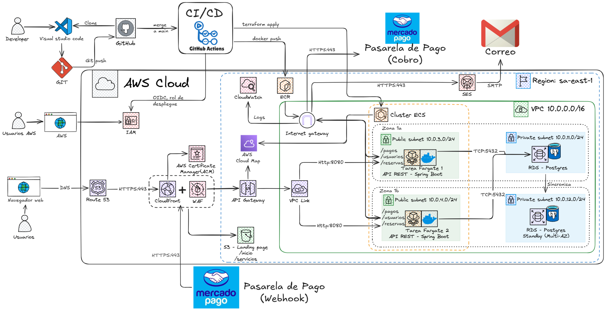

# Champion's Gym: suscripciones, pagos y aforo en AWS

Sistema web de Champion's Gym (sedes Trujillo y Chiclayo): los socios se inscriben, pagan su membresía con Mercado Pago, reservan su turno y ven el aforo de cada sede en tiempo real.

Es un **monolito modular** en Spring Boot (Java 21) que corre en **AWS ECS Fargate** y se crea completo con **Terraform**.
Atributos de calidad del proyecto: **Disponibilidad** y **Escalabilidad**.

## Cómo viaja una petición

| Qué | Camino |
|---|---|
| Páginas (`/`, `/servicios.html`) | Socio → CloudFront + WAF → S3 |
| API (`/api/...`) | Socio → CloudFront + WAF → API Gateway → VPC Link → tareas Fargate (2 zonas) → RDS PostgreSQL Multi-AZ |
| Salida de las tareas a internet | Internet Gateway → ECR, CloudWatch, SES y Mercado Pago |
| Aviso de pago (webhook) | Mercado Pago → CloudFront → API Gateway → tareas Fargate |

## Estructura del repositorio

| Carpeta | Qué hay |
|---|---|
| `app/` | API Spring Boot: módulos `suscripciones`, `aforo`, `pagos`, `correos` y `comun` |
| `frontend/` | Landing (inicio y servicios) que se publica en S3 |
| `infra/bootstrap/` | Lo que se crea una sola vez: bucket del estado, ECR, usuarios del equipo y roles de GitHub |
| `infra/modules/` | Módulos de Terraform (red, base de datos, ECS, API Gateway, web...) |
| `infra/*.tf` | Raíz de Terraform del entorno `prod`: un archivo por componente |
| `qa/` | Configuración del QA local con docker-compose (nunca toca AWS) |
| `pruebas/carga/` | Pruebas de carga con k6 |
| `docs/` | Diagrama de arquitectura y evidencias de los RNF |
| `.github/` | CI/CD con GitHub Actions y revisores |

## Equipo

| Integrante | GitHub | A cargo de |
|---|---|---|
| Fabrizio Montero | @fabriziomontero36-cyber | Cuenta AWS, red, web (S3 + CloudFront), despliegues, rollback, monitoreo y autoescalado |
| Piero Aguirre | @PieroAguirreDC | API base, suscripciones, ECS Fargate, pipeline de despliegue, pagos con Mercado Pago y pruebas de carga |
| Joaquín Portella | @jportellap | RDS, API Gateway, aforo y reservas, CI, correos con SES, logs, WAF y límites de la API |

## Cómo trabajamos

- Ramas: `main` (lo que está en AWS), `develop` (integración), `feat/<tema>` y `fix/<tema>`.
- Commits: `feat(tecnologia): Descripción`, `fix(tecnologia): Descripción` y `docs(readme): Descripción`.
- Todo entra a `develop` por Pull Request con 1 aprobación.

## Versiones

Cada fase termina con una versión en *Releases*: `v0.1.0` (fase 1), `v0.2.0` (fase 2), `v0.3.0` (fase 3) y `v1.0.0` (entrega final).
